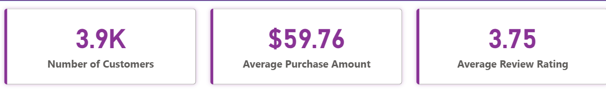
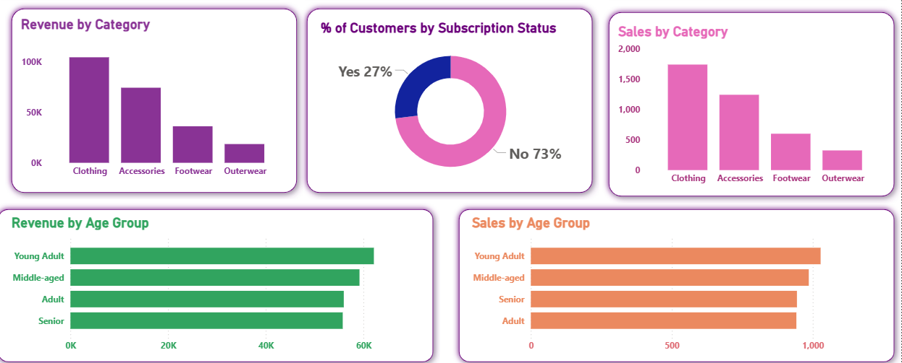

# 📊 E-Commerce Customer Experience (CX) Analytics Dashboard

An end-to-end data analytics and business intelligence solution designed to track, evaluate, and optimize consumer purchasing behavior, retention mechanics, and brand sentiment for a growing e-commerce retail platform.

---

%20dashboard.png)

## 📖 The Business Story (Project Overview)

### The Challenge
A scaling retail e-commerce platform experienced a surge in transactions but lacked a centralized, real-time mechanism to monitor customer satisfaction and purchasing patterns. Key leadership metrics—such as subscription stickiness, demographic-specific revenue breakdown, and post-purchase review sentiment—were siloed across separate transactional tables. The executive team needed to understand *who* their core customer segments were, *how much* they spent across product categories, and *what* influenced their overall satisfaction to curb potential churn and improve retention.

### The Solution
I built an interactive, human-centric **Customer Experience (CX) Dashboard** in Power BI to serve as a single source of truth for cross-functional teams (Product, Marketing, and Operations). By integrating multi-dimensional customer features into a clean star-schema data model, the dashboard translates complex behavioral data into distinct, highly interactive visual assets. 

The dashboard enables stakeholders to instantly toggle between customer demographics (Age, Gender) and behavioral traits (Subscription Status, Shipping Choices) to diagnose friction points, adjust logistics strategies, and maximize lifetime customer value.

---

## 🛠️ Tech Stack & Skills Demonstrated
* **Business Intelligence / Data Viz:** Power BI Desktop
* **Data Modeling:** Power BI Data Model View (Star Schema)
* **Data Extraction & Transformation:** Power Query (ETL, Data Type Formatting)
* **Key Fields Analyzed:** `customer_id`, `purchase_amount`, `review_rating`, `subscription_status`, `shipping_type`, `age_group`

---

## 📈 Key Metrics & Interactive Visualizations

The final interface uncovers strategic performance indicators across **3.9K unique customer profiles**:

### 1. High-Level Performance KPIs (Executive Overview)
* **Total Customer Scale:** **3.9K Customers** tracked across the active lifecycle.
* **Average Ticket Value:** **$59.76** average spend per checkout, establishing a baseline order value.
* **Customer Sentiment Baseline:** **3.75 out of 5** average review rating, highlighting target areas for service refinement.



### 2. Behavioral & Demographic Deep Dives
* **Revenue vs. Unit Volume by Category:** Side-by-side analysis reveals that **Clothing** drives the highest total revenue ($100K+) and unit sales (~1,700 items), closely followed by **Accessories**. **Outerwear** and **Footwear** show massive untapped growth potential.
* **Subscription Split Matrix:** A clean donut visualization isolates the recurring revenue pipeline. Currently, **73% of customers are non-subscribers (No)** compared to a **27% premium user base (Yes)**, providing a clear target for marketing conversion campaigns.
* **Revenue & Volume by Age Group:** Horizontal bar breakdowns segregate value performance across life stages. **Young Adults** and **Middle-Aged** cohorts represent the strongest spending power, maintaining the highest total revenue metrics.




---

## 💡 Strategic Business Recommendations

Based on the dashboard insights, I formulated three major actionable recommendations for business growth:
1. **Premium Upgrade Push:** With 73% of transactional volume coming from non-subscribers, marketing should target the high-performing *Young Adult / Clothing* segment with a tailored loyalty program to transition them into recurring subscribers.
2. **Logistics Optimization:** Cross-filtering the dashboard reveals how specific shipping options affect review ratings. Slicing by low-tier delivery methods can pinpoint if fulfillment delays are depressing the 3.75 visual rating ceiling.
3. **Targeted Merchandising:** Capitalize on the high average purchase amount ($59.76) by implementing bundling rules for *Footwear* and *Outerwear* during seasonal peaks to mirror the high transaction velocity seen in *Clothing*.


---

## 📂 Repository Structure

```bash
.
├── Customer Experience (CX) Analytics.pbix  # Live Power BI interactive dashboard file
├── Customer Experience (CX) dashboard.png   # Full-width snapshot for README display
├── README.md                                # Project documentation and business summary
├── customer_shopping_behavior.csv          # Raw enterprise transactional data
├── kpi.png                                  # High-level KPI visual block asset
└── deep.png                                 # Explanatory deep-dive visual block asset
```

---

## 🌐 Connect With Me & Portfolio Links

Feel free to explore the full suite of my data work and reach out for collaboration!

* **💼 LinkedIn:** [Abdulmalik Tajudeen](https://www.linkedin.com/in/abdulmalik-tajudeen-86602b38b)
* **🎨 Portfolio Website:** [My Portfolio Link](https://abdulmalik-ade.github.io/)
* **✉️ Email:** [My Email](mailto:abdulmaliktajudeen5@gmail.com)

---
*Disclaimer: All sensitive company information and raw data assets have been fully anonymized and synthetic attributes applied to safeguard proprietary configurations.*
